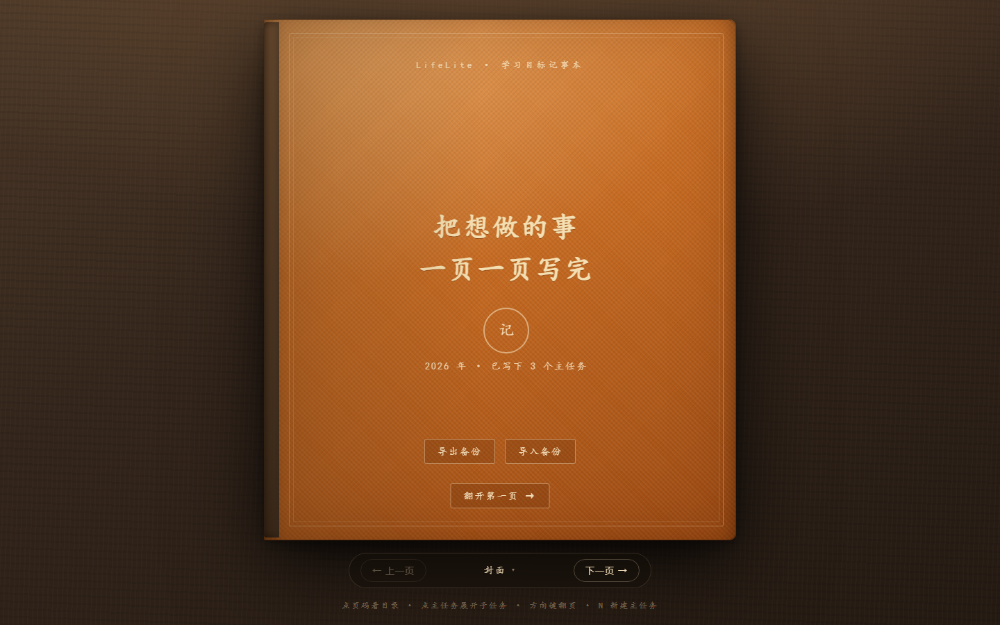
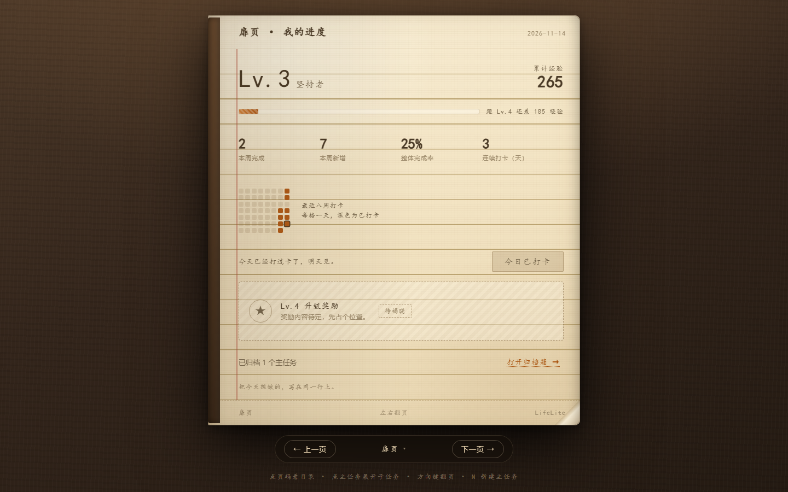
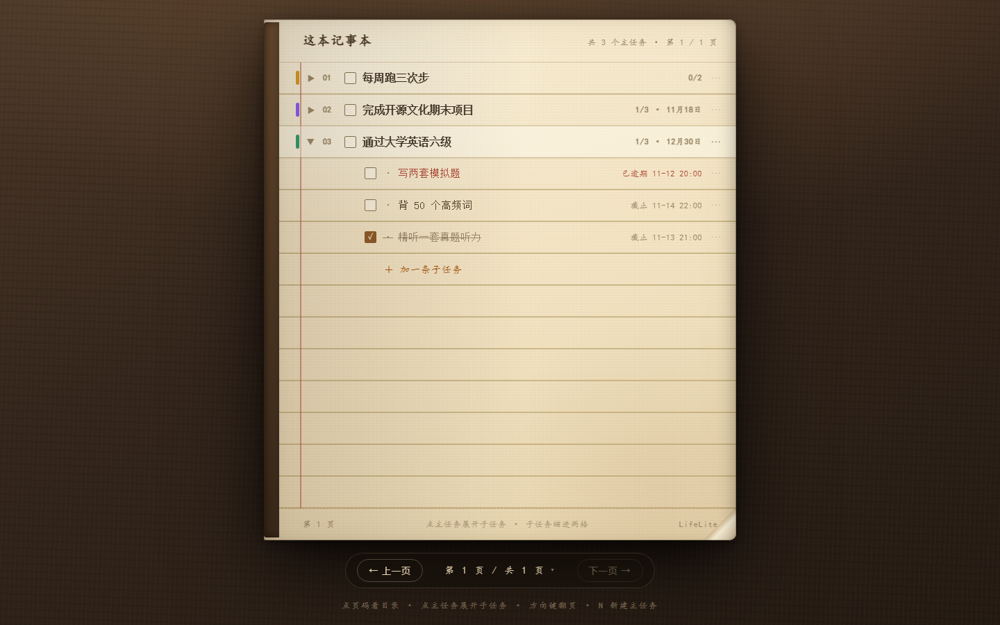
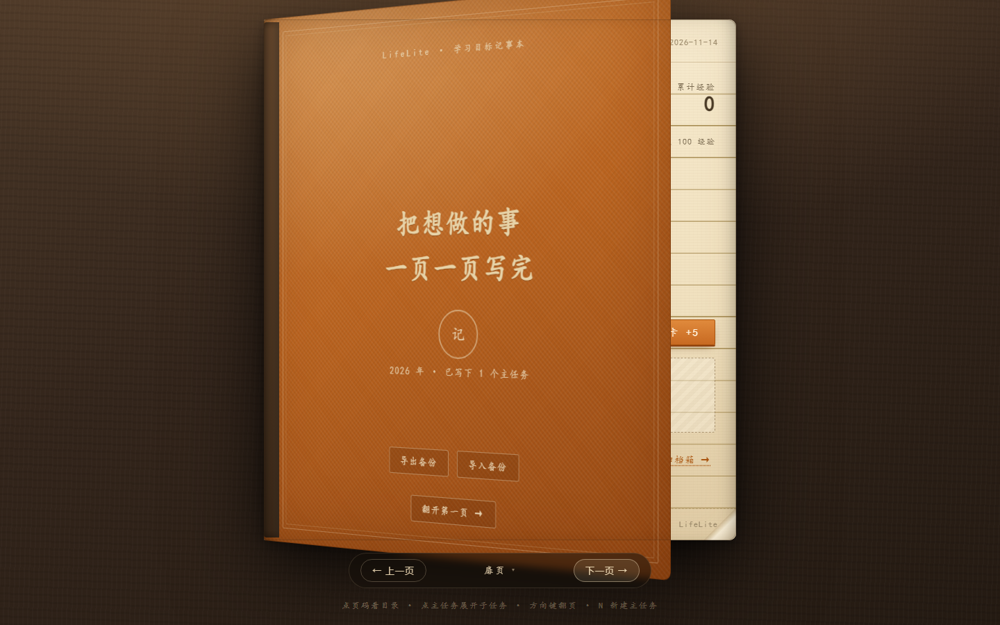
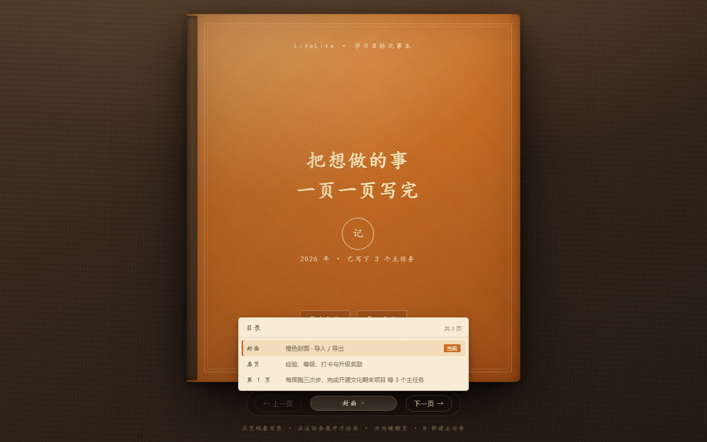
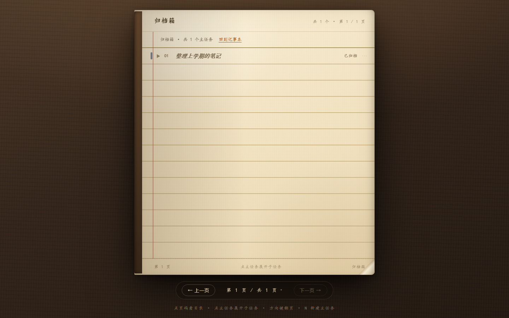
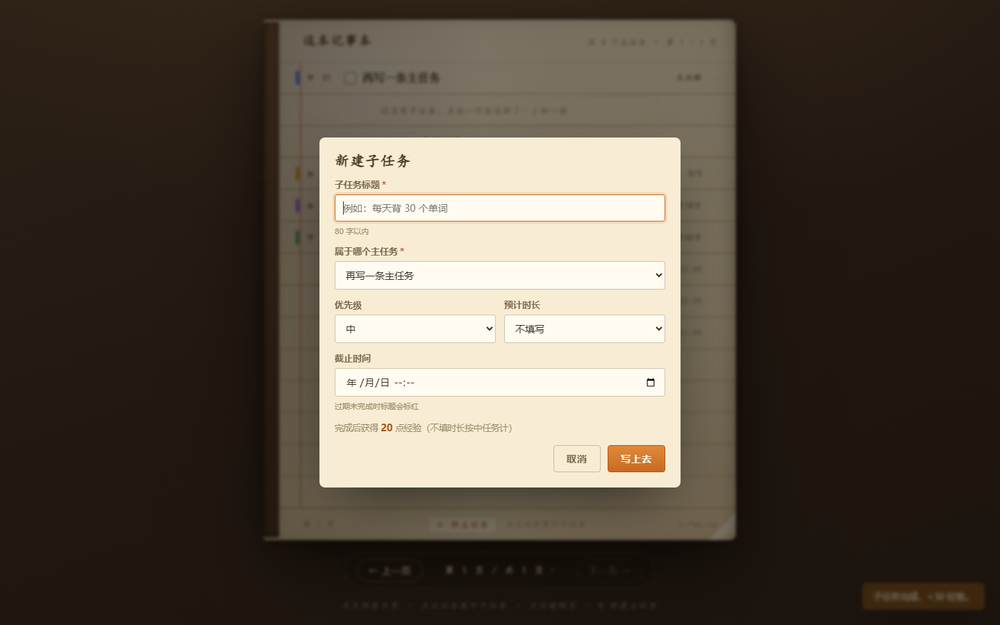

# LifeLite · 学习目标记事本

橙色封面的翻页记事本：主任务逐行写在纸上，子任务缩进两字符跟在下面，点一下就能展开收起。
经验、等级、打卡和升级奖励都在扉页，翻页时有纸张的质感——**双击 `index.html` 就能用**。

[界面截图](#界面预览) · [数据结构](docs/data-schema.md) · [设计决策](docs/design-decisions.md) · [验收清单](tests/manual-checklist.md)

---

## 界面预览

截图来自真实 Chrome 渲染，使用示例数据，存放在 [`docs/screenshots/`](docs/screenshots/)。

| 封面 | 扉页（经验 / 等级 / 升级奖励） |
| --- | --- |
|  |  |

主任务逐行写，子任务缩进跟随；行尾「⋯」里可以加子任务、编辑、归档、删除：



翻页动画绕左侧书脊、从右往左翻，翻动的是真正的纸页（含横线与页边）：



点页码可以展开目录，按摘要跳到任意一页：



归档箱、行内菜单、新建对话框：

| 归档箱 | 新建主任务 |
| --- | --- |
|  |  |

## 目录

- [界面预览](#界面预览)
- [功能特性](#功能特性)
- [快速开始](#快速开始)
- [部署到 GitHub Pages](#部署到-github-pages)
- [项目结构](#项目结构)
- [数据与体积](#数据与体积)
- [本地开发与测试](#本地开发与测试)
- [快捷键](#快捷键)
- [设计决策摘要](#设计决策摘要)
- [已知问题](#已知问题)
- [贡献指南](#贡献指南)
- [许可证](#许可证)

## 功能特性

| 编号 | 功能 | 说明 |
| --- | --- | --- |
| F1 | 主任务 | 逐行写进记事本；页脚「＋ 新主任务」随时继续写，可编辑、归档、删除 |
| F2 | 子任务 | 必须挂在主任务下；展开后缩进两字符跟随，可勾选完成、编辑、删除 |
| F3 | 进度 | 主任务行右侧显示「已完成 / 总数」，逾期标红；没有子任务显示「未拆解」 |
| F4 | 打卡与连续天数 | 扉页打卡，每天一次；最近八周热力图 |
| F5 | 经验与等级 | 完成子任务、打卡、完成主任务都加经验；等级只升不降 |
| F6 | 统计 | 扉页显示本周完成、本周新增、整体完成率、连续天数 |
| F7 | 导入 / 导出 | 封面上的两个按钮；导入前校验、覆盖前自动备份 |
| F8 | 翻页与纸张 | 每页固定 14 行横线；绕左侧书脊、从右往左翻页；`prefers-reduced-motion` 时直接切换 |
| F9 | 升级奖励 | 扉页预留占位卡，内容待定（「待揭晓」） |
| F10 | 目录 | 点页码展开目录，列出封面 / 扉页 / 每页摘要，点条目直接跳转 |

**刻意不做**：账号体系、云同步、消息推送、社交排行、深色模式、独立移动端版式。
移动端只做整体等比缩小，不做单独布局，翻页交互保留鼠标与键盘。

## 快速开始

双击 `index.html` 即可（数据保存在浏览器 `localStorage`）。也可以起一个静态服务器：

```bash
python -m http.server 8080
# 打开 http://localhost:8080
```

> `file://` 下浏览器不注册 Service Worker，安装到桌面 / 完全离线需要静态服务器或 GitHub Pages。

## 部署到 GitHub Pages

```bash
git remote add origin https://github.com/<你的用户名>/lifelite.git
git branch -M main
git push -u origin main
```

Settings → Pages → Source 选 `Deploy from a branch`，分支 `main`、目录 `/ (root)`。
零构建，推上去就能用。

## 项目结构

```text
lifelite/
├── index.html                 # 书桌 + 书页容器 + 三个对话框
├── css/
│   └── style.css              # 木桌、纸张纹理、横线、封面、翻页动画
├── js/
│   ├── storage.js             # 数据层：localStorage、迁移、导入导出校验
│   ├── profile.js             # 经验 / 等级 / 打卡 / 连续天数
│   ├── goals.js               # 主任务 CRUD、进度、弹窗
│   ├── tasks.js               # 子任务 CRUD、排序、弹窗
│   ├── stats.js               # 本周统计与七天趋势
│   ├── book.js                # 行模型、14 行分页、翻页动画、行内菜单
│   └── app.js                 # 启动、事件、Toast、确认框、导入导出、快捷键
├── manifest.json
├── sw.js                      # Service Worker（缓存版本 lifelite-v2）
├── icons/
├── docs/
│   ├── wukan-sanding.md
│   ├── data-schema.md
│   ├── design-decisions.md
│   └── screenshots/           # notebook-*.png 为当前界面截图
├── tests/
│   ├── logic-test.js          # 计算与规则自测
│   ├── static-check.js        # id / 资源 / 脚本顺序 / 体积检查
│   ├── browser-check.js       # 真实 Chrome：翻页、展开、离线、双击
│   └── manual-checklist.md
├── tools/
│   └── make-icons.py
├── .github/
├── CONTRIBUTING.md
├── LICENSE
└── README.md
```

脚本顺序固定为 `storage → profile → goals → tasks → stats → book → app`（经典脚本，无 ES Module）。

## 数据与体积

- 数据仍在 `localStorage`，键名 `lifelite.*`，字段说明见 [`docs/data-schema.md`](docs/data-schema.md)。
- 运行时不发第三方请求，没有 CDN、外链字体、统计脚本。
- 首屏资源（HTML + CSS + JS + manifest + 192 图标）约 **152 KB**，仍低于 200 KB。

## 本地开发与测试

```bash
node --check js/book.js         # 语法检查
node tests/logic-test.js        # 111 项断言：计算与规则
node tests/static-check.js      # id、资源、脚本顺序、体积
npm i puppeteer-core --no-save  # 可选：真实浏览器验收
node tests/browser-check.js     # 28 项：目录、翻页、展开、缩进、菜单、离线、file://
```

`tests/browser-check.js` 会自己起临时静态服务器，并把截图写到 `docs/screenshots/`。

## 快捷键

| 按键 | 作用 |
| --- | --- |
| 点击页码 | 展开目录，跳转到指定页 |
| `N` | 新建主任务 |
| `←` / `PageUp` | 上一页 |
| `→` / `PageDown` | 下一页 |
| `Enter` | 在表单中保存 |
| `Esc` | 关闭对话框 |

## 设计决策摘要

完整记录见 [`docs/design-decisions.md`](docs/design-decisions.md)。界面部分的关键取舍：

1. **每页 14 行**：行数与行高由 grid 固定，横线用 `background-size: 100% / 14` 画在行底，空行也有线。
2. **先摊平再分页**：主任务与展开的子任务先变成扁平行数组，再按 14 行切块；展开后允许当前页顺延重排。
3. **翻页用真纸**：翻动层克隆整张 `.sheet`（含背景与横线），绕左侧书脊 `rotateY` 从右往左翻，而不是遮罩切换。
4. **经验只加不减**：撤销完成、删除子任务都不回收经验（沿用旧设计）。
5. **零依赖零构建**：仍然双击可用；离线只在 http(s) 下生效。

## 已知问题

- **移动端不做独立版式**：窄屏整体缩小，触屏翻页手势未实现，翻页靠按钮与键盘。
- **数据只在当前浏览器**：换设备需要手动导出 / 导入 JSON。
- **日期按本机时间**：改系统时间会让「今天」跳变。
- **存在刷经验漏洞**：完成再删除不回收经验，是刻意的正向激励取舍。
- **`file://` 无 Service Worker**：控制台会出现 manifest 的 CORS 警告，属预期噪音。
- **升级奖励是占位**：扉页的「待揭晓」卡片还没有具体奖励内容。

## 贡献指南

分支、提交信息、Issue/PR 模板与代码风格见 [`CONTRIBUTING.md`](CONTRIBUTING.md)。

## 许可证

[MIT](LICENSE) © 2026 LifeLite Team

